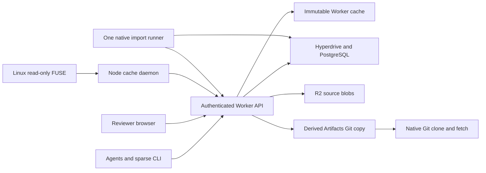

# Architecture and tradeoffs

## Public Scion design

Anthropic's October 13, 2026 article describes an online-first source service: immutable incremental changesets, distributed file storage, server-side operations and derived data, sparse clients, shared caching, and minimal shared mutable state. Squali follows that model. Anthropic has not published the complete Scion implementation or acceptance specification; its performance claims are not Squali measurements.

## Authority and derivation

A canonical changeset is a SHA-256 identity over its parents, first-parent path delta and preserved commit metadata. Deltas record content identity, deletion and mode changes. R2 stores independent gzip blobs under content-addressed keys. PostgreSQL stores the changeset log, path deltas, refs and workflow state. Creating a proposal does not create a Git ref or call Artifacts.

Git SHA-1 object identities remain available for interoperability. Imported raw encodings and historical permission modes are retained. Git commits and trees can be reconstructed from canonical changesets; reconstruction is checked against independent native Git fixtures. Git packs are transport, not authoritative source storage. Authoritative R2 blobs have no expiry. A separate disposable cache bucket expires after seven days.

Derived records are versioned and rebuildable. One dependency resolver handles trees, generations, graph skip pointers, path events and parent-dependent blame. Eager batches and lazy misses share ordering, cache reuse, cycle checks and finite bounds. Graph and path storage adapters retain vectorized SQL. Path history skips unrelated churn; cached metadata answers keep their existing identities across this migration. See the [fixed acceptance checklist](scion-acceptance.md) for reconstruction and native-Git evidence.

## Concurrency and publication

Changesets are immutable and independent; only publication moves a shared main ref. A durable journal freezes a publication's input selection, author, timestamp and expected head. The server computes a deterministic result and updates main using compare-and-swap. Approval is tied to the immutable proposal version. Dependencies are topologically ordered and checked for authorization.

Compatible text edits use bounded three-way reconciliation. Unresolved edits, incompatible modes and work-limit violations return conflicts. Revision or rebase creates new proposals requiring fresh approval. Continuous rebase retains its input identities and cursor, processes up to eight of 64 single-parent commits per request, and resumes conflicts without moving main. Semantic policies can additionally preserve a JavaScript AST and selected tool directives or a parsed JSON value. These checks do not establish general program equivalence.

Source publication and cancellation retain the same recoverable journal semantics as the original Git adapter. Lost acknowledgements are reconciled against the saved immutable result. Cancellation installs an unchanged-tree audit commit against the expected head. One winning compare-and-swap prevents a delayed losing operation from replacing it. An unexpected head change stops for reconciliation.

Database transactions cover short metadata transitions. Semantic review preloads immutable content, then enforces the current policy in its transaction. Rebase persists progress through optimistic compare-and-swap. Git export uses a ten-minute SQL lease for network work and a short transaction to confirm its object index. Tests prove progress with one database connection and independent workspaces during a slow export.

## Git compatibility

Artifacts stores a derived copy of published refs and their reachable object closure. Unpublished proposals are excluded. An export index avoids fetching unchanged source blobs on later clones and publishes. Ambiguous pushes reconcile refs before another transfer. Deleting the compatibility copy leaves source data intact; bounded export can recreate it.

The Worker admits at most 8,192 new objects and 16 MiB expanded content per export. A large native import seeds Artifacts directly from its retained Git cache using a short-lived credential tied to the current internal job lease. It verifies every advertised branch and tag, then records the exported closure. Ordinary project tokens cannot obtain that credential.

Artifacts currently limits a repository to 1 GB. Source storage has independent admission limits. When a native repository exceeds the configured compatibility budget, source import can finish with `gitCompatibility.state=provider_limit`; Git requests return an explicit 413. No truncation or incomplete Git copy is presented as success.

Legacy Artifacts-backed workspaces retain the original adapter. There, Git remains authoritative and proposals use private refs; their journal reconciles cross-system Git/SQL acknowledgements. New production workspaces use source authority by default.

## Imports, caches and failure isolation

A single runner on the existing Azure VM listens for PostgreSQL jobs and reconciles missed notifications every 30 seconds. Idle operation performs no paid HTTP polling. A fleet advisory lock, one active job and a 1 GiB service memory limit bound capacity. GitHub credentials come through a live job lease; they never enter clone URLs, stored Git configuration or browser responses.

The importer freezes refs and an object inventory, verifies identities, asks which objects are missing and uploads only missing data. A persistent journal retains request, byte, object and execution budgets across restarts. Healthy process checkpoints continue the same job. Failed jobs stop and require explicit recovery. Metadata batches that exceed the validated sealing budget halve their admission size; all rejected calls still count. No other failure automatically retries.

R2 upload claims prevent concurrent duplicate writes. Unknown outcomes are checked by immutable key. Only a confirmed missing object can be retried after its lease expires, at most three attempts. A source read outage fails closed. Node caches coalesce concurrent misses and retain cooldowns; their clients cannot bypass a failed node by directly contacting the source. Checked cache snapshots support reuse. Linux FUSE mounts hydrate ordinary file reads through the node protocol; they are read-only.

Authorization precedes caches and source reads. Clerk sessions isolate personal workspaces. Expiring project credentials can restrict paths. Whole-repository raw protocols, Git export and administration reject directory-scoped credentials to prevent metadata or object escape.

## Costs and limits

Production currently caps source R2 at 200,000 reads and 200,000 writes/month, disposable R2 cache at 20,000 reads and 2,000 writes/month, Artifacts at 2,000 conservative reservations/month, and workspaces at 100. Failed and unknown attempts count. A cap is an application admission control, not a replacement for provider billing or account-wide controls. Direct access outside Squali is not covered.

Native import defaults to 500,000 objects, 16 GiB raw data and 12,000 HTTP attempts. Each job has a cumulative eight-hour budget and at most three explicit recovery attempts. The service supervises finite worker processes, while stopped jobs stay stopped. No application Durable Object, D1, per-agent database or additional VM is created.

Authoritative storage persists. R2 Standard list prices are $0.015/GB-month, $4.50/million Class A and $0.36/million Class B, with shared allowances and billing-unit rounding. Artifacts, Workers, PostgreSQL and VM capacity are additional. Existing Azure capacity still has a cost. [The import admission budget](source-import-budget.md) records the unique input and worst-case operation bounds; [evidence](evidence/2026-10-15-source/) separates application reservations from provider measurements.

The API uses targeted placement near Azure eastus2 and a five-connection Hyperdrive origin pool. Static assets are distributed separately. Performance reports state client location, dataset, concurrency, cache conditions and scope. Local results do not establish production throughput or Anthropic-scale operation.

## Sources

- [Anthropic: Redesigning source control](https://www.anthropic.com/engineering/redesigning-source-control)
- [Artifacts Workers binding](https://developers.cloudflare.com/artifacts/api/workers-binding/)
- [Artifacts Git protocol](https://developers.cloudflare.com/artifacts/api/git-protocol/)
- [Artifacts limits](https://developers.cloudflare.com/artifacts/platform/limits/) and [pricing](https://developers.cloudflare.com/artifacts/platform/pricing/)
- [R2 pricing](https://developers.cloudflare.com/r2/pricing/)
