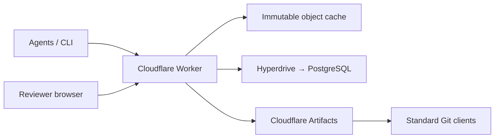

# Architecture and tradeoffs

## What we take from Scion

Anthropic's October 13, 2026 engineering article describes an online-first source-control service. The transferable ideas are client/server asymmetry, incremental commits, independently cacheable immutable objects, sparse access, minimal shared mutable state, and retained intent. Scion's reported speedups are its own results, not Squali's.

Squali keeps Git compatibility rather than recreating Scion's storage system. Artifacts supplies repository durability and Git interoperability. Workers supply authenticated APIs and a browser application. PostgreSQL stores workflow metadata, path indexes, idempotency records, review decisions, a publication journal, and operation reservations.

## Data and concurrency

A proposal has an immutable base commit and its own Git commit under `refs/heads/weave/<change-id>`. Those refs keep Git objects reachable without creating an entire repository for every agent. The change stores author, intent, arbitrary bounded context, evidence, dependency IDs and changed-file object IDs. File contents are not duplicated into PostgreSQL.

The Worker hashes blobs, rewrites affected Git trees, constructs a commit and sends a valid pack through Git smart HTTP. It reads sibling entries only in affected directories; this is proportional to the changed ancestor trees, not strictly O(changed bytes) in an extremely wide directory. Pack compression uses level 1 to reduce Worker CPU. Existing blobs remain on the server.

Proposals hold their own SQL row lock only while finalizing metadata. Git I/O runs outside database transactions, so even a one-connection pool makes progress. A workspace's main branch is the intentional publication boundary. Reviews and publication journal transitions take a short PostgreSQL advisory lock for that workspace; proposal authors remain independent. A durable publication journal freezes the base, inputs, author and timestamp. Concurrent retries build the same commit and converge through Git CAS; an active marker is not used as a lease. Unrelated projects have independent publication locks. Publishing many changes amortizes main-branch coordination.

A preview topologically orders dependencies and checks each file against its own base. Nonoverlapping text edits merge using diff3; equally sized conflicting regions receive a conservative per-line comparison. Deletions, incompatible edits, unsupported modes and bounded-work limits return explicit conflicts. Text compatibility does not establish semantic compatibility. A human or trusted reviewer must assess behavior and evidence.

## Correctness across PostgreSQL and Git

Git and PostgreSQL cannot participate in one atomic transaction. Squali therefore commits a publication journal before sending the Git update. The commit is deterministic from its saved timestamp, selected changes and frozen parent list. New commits use the old main as first parent and each selected proposal as an additional parent. Git's expected-old-object check prevents overwriting an external push.

If the network fails after Git accepts the pack, a retry checks whether main equals the journal's commit. If so, it finalizes the SQL metadata without another push. If the push never happened and main remains at the recorded base, the operation can be retried or explicitly cancelled. If an external writer advances or force-pushes main during an unresolved operation, the prototype stops for reconciliation; it does not guess or rewrite Git. Cancellation persists its own intent and appends an unchanged-tree audit commit using the same expected-old-head CAS. Either publication or cancellation wins; a delayed losing push cannot update the ref. Retrying cancellation recovers the same audit commit. Both operations use the journal’s original author and time, and finalization emits one event. No lease expiry guesses whether an external write is still active.

No global transaction covers all projects. No application Durable Object or per-agent database is created. The optional local adapter runs ordinary `git http-backend`; it is not a fake source store.

## Caching and cost

Tree, commit and blob cache keys contain repository, object type and immutable Git ID. Every HTTP request is authorized before cache lookup. Mutable refs, approvals and database queries are not cached. The Worker isolate cache is an 8 MiB LRU, backed by Cloudflare Cache API, then private R2, then Artifacts. R2 stores objects up to 1 MiB for seven days, with persistent write deduplication and monthly read/write reservations. R2 read outages fail closed instead of fanning out to Artifacts. A failed upload leaves a five-minute cooldown claim; a later cache miss cannot repeatedly refill it from Artifacts. A process killed before recording failure can leave its claim until the seven-day expiry. CLI working copies share a 64 MiB disk cache. Cache loss does not change source correctness. Derived query records live in versioned PostgreSQL rows.

All live Artifacts calls reserve a conservative number of provider calls in PostgreSQL before dispatch. Missing or invalid caps fail closed. Unknown outcomes count, and there are no automatic paid retries. The default cap is 2,000 reserved calls per month, with at most 10 repositories. This is a client-side upper bound on attempts, not a replacement for Cloudflare's bill or account-wide controls. Direct users of the Artifacts namespace bypass this application's cap.

Cloudflare's published October 14 pricing starts with 10,000 included operations and 1 GB, then $0.15/1,000 operations and $0.50/GB-month. If none of the shared allowance remained, 2,000 operations would be at most $0.30 of operation charges, subject to the provider's actual billing definition. Workers Paid, database capacity, storage and network are additional. Repository storage persists until explicitly removed.

## Scaling limits

Artifacts currently allows 200 Git requests/second per repository and 200 control-plane requests/second per namespace in 10-second windows. Its 1 GB repository cap rules out a direct copy of Anthropic's enormous monorepo. Scale independent projects across repositories and namespaces, then measure contention and costs before raising caps. Within a hot single repo, batching reduces main-branch operations but cannot remove serialization of one authoritative head.

The current UI lists bounded recent windows rather than an unbounded archive. Review, read and publication APIs are implemented; distributed load validation, server-side CI, semantic merge validation, scheduled GC, full-text code search and complete large-history skip-list/blame indices remain open. Bounded server-side metadata queries and path search are implemented.

## Sources

- https://www.anthropic.com/engineering/redesigning-source-control
- https://developers.cloudflare.com/artifacts/api/workers-binding/
- https://developers.cloudflare.com/artifacts/api/git-protocol/
- https://developers.cloudflare.com/artifacts/platform/limits/
- https://developers.cloudflare.com/artifacts/platform/pricing/

## Execution placement

The production API uses `placement.region = "azure:eastus2"` to run near the dedicated PostgreSQL database. Static assets remain served near visitors. Cloudflare accepted this as targeted placement. A bounded before/after observation made three read-only `/api/usage` requests per configuration and no Artifacts calls: median total HTTP duration was 1.505 s before and 1.257 s after. This small sequential sample includes the local network and TLS setup; it is not a load benchmark or a guaranteed improvement. See [placement evidence](evidence/placement.json) and [Cloudflare placement documentation](https://developers.cloudflare.com/workers/configuration/placement/).

R2 standard storage list prices are $0.015/GB-month, $4.50/million Class A and $0.36/million Class B, with shared included allowances and upward billing-unit rounding. At 2,000 write and 20,000 read reservations/month, seven-day expiry and 1 MiB entries, storage can approach 4 GiB across a month boundary. If no shared allowance remains, billing-unit rounding can dominate the small raw operation estimate (roughly $4.94/month for this cache in isolation). Account-wide usage, lifecycle timing, Workers, SQL and Artifacts are separate. See https://developers.cloudflare.com/r2/pricing/.
