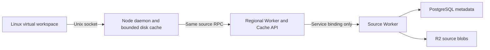

# Independent regional RPC cache

Squali now has a separate `squali-regional` Worker for the tree/blob read path described in [Anthropic's Scion article](https://www.anthropic.com/engineering/redesigning-source-control). It runs at Cloudflare's default edge placement, while `gridheap-weave` retains placement near Azure East US 2. Cloudflare Cache API entries are local to a Cloudflare location; this is not a fixed fleet of dedicated regional machines.

The RPC URL and raw object format are unchanged: `POST /api/projects/:project/rpc`. `object` reads immutable bytes, `stat` reads canonical batches of immutable sizes/types, `head` always reads current source state, and `authorize` returns a short authorization deadline. The daemon uses this RPC for authorization as well as data. It has no alternate origin address or fallback path.

Cloudflare does not support an infix wildcard in a route. The regional Worker therefore owns `squa.li/api/projects/*`, handles RPCs, and forwards other project operations through the source service binding. Existing project operations retain source authentication and behavior. The source custom domain continues to serve the rest of the application. Workers.dev and preview URLs remain disabled on both Workers.

## Authorization and isolation

- Every request needs a whole-project credential. Directory-scoped credentials cannot use raw object RPCs. Authorization happens before cache access.
- Authorization is cached for at most **30 seconds**, clamped to the actual machine-token or Clerk session expiry. The daemon preserves that deadline instead of adding another 30 seconds. Revocation therefore takes effect for cached reads after the existing lease expires, within 30 seconds; requests already in flight can finish. Other source operations still check authorization on every request.
- Object keys contain the project and canonical query, so different authorized users of one project reuse data. Different projects cannot reuse admissions. Tokens are hashed for the in-memory lease key and never appear in object cache keys, responses or logs.
- Objects are verified against their Git type, length and SHA-1 identity. Stat results must contain exactly the requested IDs, supported types and valid sizes. Cache failures or corrupt entries return an error without fetching the object from source.
- Authorization refreshes can still contact the source when an authorization lease is absent. They use the same upstream admission limits as object reads; the cache-failure guarantee concerns data fallback, not eliminating authentication.

## Bounds and failure behavior

| Control | Current setting |
|---|---|
| Active RPC handlers | 16 per isolate; excess receives 503 |
| Active source RPCs | 8 per production isolate, including authorization; no waiting queue |
| Source admission | 600 calls per minute per Cloudflare location, shared across credentials and RPC operations |
| RPC deadline | 10 seconds; no automatic retry |
| Source outage circuit | 5 seconds after transport failure, timeout or a source 5xx |
| Failed immutable request | 5-second cooldown, at most 1,024 records |
| Authorization leases | At most 1,024 records |
| Request body | 128 KiB; stat batches at most 2,000 IDs |
| Cached object size | At most 1 MiB per object; stat response at most 512 KiB |
| Cache lifetime | 24 hours, immutable; Cloudflare may evict earlier |
| Larger object response | Stream through the same tier, up to 32 MiB; never buffer or cache the whole large response here |

The Cloudflare rate-limit binding is permissive and eventually consistent. It protects upstream load; it is **not a global billing hard cap**. Existing PostgreSQL admission counters remain the hard source-R2 and Artifacts operation caps. The Worker CPU setting remains 30 seconds, matching the source application because this route also forwards metadata/project operations; RPC work is separately bounded by object size, concurrency and deadline.

Concurrent small-object misses share one source request within an isolate. Coalescing is not global across locations or isolates. A large stream retains its admission slot until completion, cancellation or timeout. A second request for that in-flight large object receives 503; the client can retry explicitly. The stream verifies its hash at EOF, so corrupted or truncated streams abort and the node does not cache them. No automatic cache purge, origin bypass, retries, backfill, D1 or application Durable Object is added.

## Cost and observed results

[Cloudflare's pricing](https://developers.cloudflare.com/workers/platform/pricing/) and [service-binding documentation](https://developers.cloudflare.com/workers/runtime-apis/bindings/service-bindings/) were checked on October 15, 2026. On Workers Standard, a service-binding subrequest does not add a request fee; CPU is summed across the calling and called Workers. Existing account allowances apply. At excess rates, one million outer requests cost $0.30, and one million CPU ms cost $0.02. This is a rate calculation, not a measured production invoice or hit rate.

The local HTTP test shows **16 readers → 1 source object request**. Two real Python node daemons also reuse one regional object request, then reject cached reads when their credential expires. Actual workerd verifies the service binding, Cache API warm hits, concurrent miss coalescing, project-API forwarding and unauthenticated denial. Real Linux acceptance runs the writable virtual workspace through the regional tier. All of these tests use local fixtures and zero external provider calls.

These results do not establish Scion's 99% fleet hit rate or 200-fold CPU/memory reduction. Objects above 1 MiB are not retained in this regional cache, and its per-location admission setting needs a representative, bounded capacity test before any increase. [Commands and evidence](evidence/2026-10-15-regional/README.md).

### Production checkpoint

Source Worker `c81e2b62-86d2-403a-92b0-e83056b77c02` and regional Worker `c71c1cbb-4e09-418f-bfa9-e0f850862fe4` were deployed on October 15. A retained 50-byte source fixture returned `miss`, then `hit`, with exact Git and content identity. The existing project API also returned 200 through the service binding. First and warm object requests took 1,410 ms and 968 ms respectively from the development machine; these are individual observations including connection/network overhead, not a benchmark or a new private-repository cold-blame result.

The smoke used five HTTP attempts in total, including one correctly denied reader credential that did not have access to this fixture. The subsequent four read-only checks used an existing authorized credential. No credential or grant was created. All failures remain recorded, automatic retries were zero, and completed verification replays offline. No import, provider quota increase or recurring job was added. Production source-R2 operations were not separately queried for this small smoke; the `miss`/`hit` evidence must not be relabeled as a measured R2 bill.

## Deployment order

1. Run the recorded local checks.
2. Deploy the source Worker first. Its added `authorize` RPC is backward compatible with existing clients.
3. Deploy `wrangler.regional.jsonc`, which binds to the existing source Worker.
4. Update node clients from this repository. Their authorization follows the same RPC path and preserves the server deadline.

No scheduled work is installed. Cache warming occurs only through normal requests, using the existing immutable source data.
